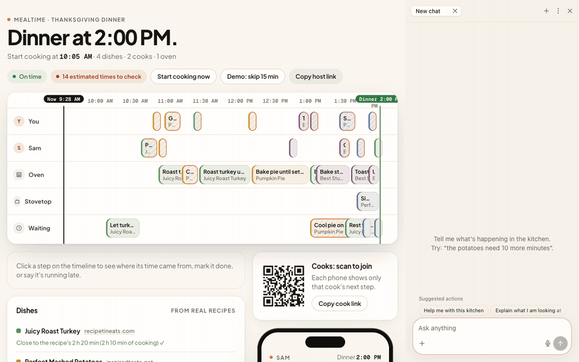

# Mealtime

Mealtime plans a big meal backwards from dinner time, so every dish comes out together, and sends each cook their next step on their phone.

It's built on Agent-Native, Builder.io's framework where an AI agent and the app's screens use the same actions and data. That matters here because every change (a cook pressing Start, the host editing a time, the agent handling "the turkey's late") goes through one action, so nothing needs a separate agent integration and nothing drifts out of sync. Tell the agent "the potatoes need 10 more minutes" and the timeline, both phones and the activity log update together. The host taps to approve before dinner time moves.



*A real run, recorded from the app: the agent calls `get-kitchen` and `report-delay`, the timeline reflows, and dinner only moves after Approve.*

**Live app: https://mealtime-kitchen.vercel.app**. Every visitor gets their own demo kitchen with no sign-up. Talking to the agent asks you to sign up (any email, no verification, about 15 seconds), because the framework only lets signed-in people use the site's AI key. Until then, the kitchen page plays a recorded run of the agent and has a button that runs the agent's own `report-delay` action on your kitchen, so you can see the reflow and the approval card without an account.

## Try it in 30 seconds

1. Open the live app. A Thanksgiving dinner for two cooks, built from four real recipes, is already planned.
2. Click any bar on the timeline. You'll see the sentence from the recipe that the step's time comes from.
3. Press **Start cooking now**, then **Start** on Sam's phone (the frame on the right, or scan the QR code with your own phone).
4. Sign in, then tell the agent "the turkey needs 20 more minutes". It adds the time to the right step, works out how late dinner will be, and puts an approval card at the top of the page. Nothing moves until you press Approve.

## How it works

- The scheduler in `server/lib/scheduler.ts` is plain code, not the model. It works back from dinner time and places each step as late as it can go. It won't double-book an oven (two dishes share one only when their temperatures are close), a burner, or a cook's hands. Steps that are done, running or pinned stay where they are. If a step would have to start in the past, dinner slips and the header says by how much.
- The agent splits a recipe into steps and copies the recipe's own words for each time, for example "bake for 25 to 30 minutes". `set-dish-steps` checks that sentence against the recipe text. A step whose time the recipe doesn't give is marked as an estimate (amber dashed border) until the host confirms it.
- Moving dinner (`move-dinner`) or handing a step to another cook (`reassign-step`) uses the framework's `needsApproval`: a click by a person in the app runs at once, but when the agent, an MCP client or another agent calls it, the framework stops and asks the host to approve that exact call. A cook who reports a delay from their phone leaves a one-tap card on the host's timeline instead.
- The "Right now" strip above the timeline shows what each cook and the oven should be on this minute, with one button to start the step, finish it or add 10 minutes. It calls the same actions as the timeline, the phones and the agent.
- The timeline buttons, the cook phones and the agent all call the same actions in `actions/`. The activity log records who made each change and where it came from (timeline, phone or agent). The same actions are also offered over the app's MCP endpoint, which asks for sign-in.

## Use it from your AI assistant (MCP)

The same actions are an MCP server, so Claude Code, Cursor or any MCP client can run the kitchen:

```bash
npx @agent-native/core@latest connect https://mealtime-kitchen.vercel.app
```

Sign in when your client asks, then give it a kitchen link and say "the potatoes need 10 more minutes". I checked this against a local copy: the client sees all 12 kitchen tools, reads the plan with `get-kitchen`, and when it tries `move-dinner` the framework refuses until a person approves.

## How well the recipe splitting works

I ran the same splitting rules on 20 recipes from 6 recipe sites (`scripts/split-recipes.ts --test`, results in `fixtures/recipe-check.json`):

- 136 steps in total. For 77 of them the model quoted a time from the recipe; code found 73 of those quotes in the recipe text and turned the other 4 into estimates.
- The other 59 steps have no time in the recipe, so they show up as estimates for the host to check.
- For 12 of the 20 recipes, the steps add up to within 25% of the recipe's own stated total. The app shows that check next to each dish.

## Run it locally

```bash
pnpm install
cp .env.example .env.local   # add ANTHROPIC_API_KEY for the agent
pnpm dev
```

Without a database URL the app uses a local embedded Postgres. Tests: `pnpm exec vitest run server/lib`.

## Built during the hackathon

Everything here was written during the Agent-Native Hackathon on top of the framework's chat starter template. The demo recipes are saved copies of public recipe pages, credited by site on each dish.
